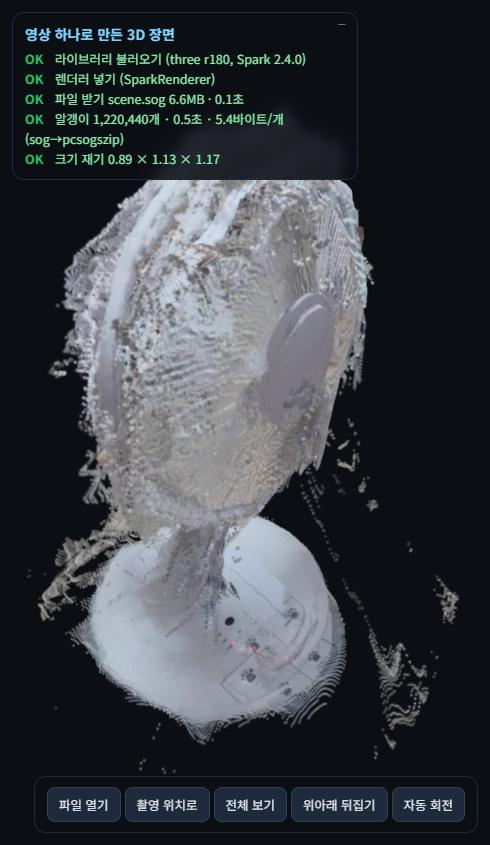

# 폰 영상 하나로 만든 3D 선풍기

- 뷰어: https://agogdim99-ux.github.io/room-3d-fan/
- 장면 파일 직접 받기: https://agogdim99-ux.github.io/room-3d-fan/scene.sog



## 1. 고른 공간과 공개 판단

집 안 바닥에 세워 둔 **선풍기 한 대**입니다.
**공개해도 되는 근거:** 장면에서 바닥, 벽, 주변 물건을 잘라 내고 선풍기만 남겼습니다. 그래서 사람 얼굴, 문패, 창밖 풍경, 차량 번호처럼 집이나 사람을 알아볼 수 있는 정보가 없습니다.
원본 영상, 추출한 사진, 방 전체 점 파일은 저장소에 올리지 않았습니다.

## 2. 촬영

| 항목 | 값 |
|---|---|
| 영상 | 34.1초, 1080×1440 세로, 폰 카메라 |
| 걸은 경로 | 선풍기 둘레를 한 바퀴 가까이(347°) 돌고, 끝에서 이미 지나온 쪽으로 조금 되돌아옴 |
| 추출 프레임 | 영상 전체에서 고르게 24장, 한 장 768×1024 (모델 입력은 518×392) |
| 복원 | MapAnything `facebook/map-anything-apache`, 코랩 Tesla T4, fp16 |
| 복원 시간 / 최대 GPU 메모리 | 18.7초 / 7.32GB |

권장 조건(가로, 15~20초)과 달리 **세로이고 34초**입니다. 세로라 화면의 위아래를 바닥이 많이 차지했고, 길이가 길어 24장 사이 간격이 약 1.4초로 벌어졌습니다.

## 3. 점과 카메라

| 항목 | 값 |
|---|---|
| 점 개수 (방 전체) | 4,347,204개 (튄 점 0.5% 제거 전 4,449,638개) |
| 카메라 퍼짐 비 | 2.24 / 6.68 = **0.335** (0.1보다 커서 제자리 회전이 아님) |
| 선풍기만 남긴 점 | 1,220,440개 (카메라 시선이 모이는 축에서 반지름 0.45m 안, 바닥 위 3.5cm부터) |

**실제 촬영 경로와 비교한 결과:** 카메라 위치를 바닥 평면에 내려 보면, 첫 장 기준으로 0° → 176°까지 고르게 돌고 → −149°까지 이어 간 다음 → 134°로 되돌아옵니다. 실제로 걸은 길(한 바퀴 가까이 돈 뒤 조금 되돌아옴)과 맞습니다.

- 선풍기까지 수평거리: 0.43~0.94m
- 카메라 높이: 바닥에서 1.24~2.06m (내려다보며 찍음)
- 카메라 이동 거리: 모두 합쳐 4.72m, 장 사이 평균 0.21m
- 가장 크게 건너뛴 곳: 21번 → 22번 장 사이 0.59m (되돌아오기 시작한 구간)

## 4. 알갱이 파일과 형식 비교

- 반지름: K × 가장 긴 변 ÷ √N = 1.4 × 1.165 ÷ √1,220,440 = **0.00148m**
- 불투명도 0.9, 0차 구면 조화만 저장(`f_rest` 없음)
- 변환 도구: `npx -y @playcanvas/splat-transform@3.10.3 -w`, 이 PC의 CPU에서 실행

| 형식 | 파일 크기(바이트) | 변환 시간 | 알갱이 개수 | 알갱이당 바이트 | 같은 시점 화면 차이 (PLY 렌더 대비 PSNR) |
|---|---:|---:|---:|---:|---:|
| `.ply` (원본) | 82,990,337 | 3.9초 (점→PLY) | 1,220,440 | 68.00 | 기준 |
| `.compressed.ply` | 19,870,997 | 3.56초 | 1,220,440 | 16.28 | 44.2dB |
| `.sog` | **6,631,308** | 4.00초 | 1,220,440 | **5.43** | **45.0dB** |
| `.spz` | 7,736,094 | 4.40초 | 1,220,440 | 6.34 | 35.7dB |

- **알갱이 개수:** 네 파일을 모두 뷰어에 끌어다 놓아 셌고, 모두 1,220,440개로 같았습니다.
- **화면 차이:** 네 형식을 같은 카메라 위치에서 렌더해, 받침의 조작부(작은 버튼과 무늬)를 잘라 PLY 렌더와 비교했습니다. 정답 사진과 비교한 값이 아니라, 압축으로 화면이 얼마나 바뀌는지를 본 값입니다.
- **눈으로 본 차이:** 네 형식이 거의 같았습니다. `.spz`만 화소 차이가 조금 더 컸습니다.
- **고른 형식:** 가장 작으면서 PLY와 가장 가깝게 보인 `.sog`를 Pages에 올렸습니다. GitHub 한도(100MiB)보다 훨씬 작습니다.
- **참고 (방 전체판, 4,347,204개):** `.ply` 295,610,289바이트, `.sog` 20,902,716바이트

## 5. 첫 화면까지 걸린 시간

| 기기 | 브라우저 | 통신 | 파일 받기 | 알갱이 풀기 | 비고 |
|---|---|---|---:|---:|---|
| Windows PC | Chromium 기반 | 유선/와이파이 | 1.0초 | 0.5초 | Pages 주소, 처음 받을 때 |
| 내 폰 | 폰 기본 브라우저 | 와이파이 | 0.9초 | 0.5초 | |
| 다른 사람 폰 | 삼성 인터넷 | 5G | 0.3초 | 0.3초 | 처음 받는 기기 |

시간은 뷰어 왼쪽 위 진행 표시의 "파일 받기"와 "알갱이" 줄에 나옵니다.

## 6. 잘 보이는 방향과 안 나온 자리

**잘 보이는 방향:** 촬영 위치(첫 장)에서 비스듬히 내려다볼 때입니다. "촬영 위치로" 단추를 누르면 이 시점이 됩니다.
- 받침 위 조작부의 버튼과 무늬, 뒤쪽 모터 덮개의 둥근 모양까지 알아볼 수 있습니다.
- 카메라가 1.24~2.06m 높이에서 0.4~0.9m 거리를 두고 내려다봤기 때문에, 위와 옆면은 시차가 충분했습니다.

**안 나온 자리와 이유:**

1. **망(그릴)이 뿌연 껍질처럼 보임.** 사진은 모델에 518×392 크기로 줄어 들어갑니다. 이 거리에서는 화소 하나가 수 mm라서 가는 철사를 따로 잡지 못합니다. 그래서 망 앞뒤의 깊이가 섞여 반투명한 막처럼 나옵니다.
2. **받침 가장자리와 기둥에 줄무늬처럼 겹친 층.** 같은 면이 사진마다 조금씩 다른 깊이로 잡혔고, 카메라 위치 추정(정렬)이 조금 어긋나 면이 여러 겹으로 그려졌습니다.
   - 장 사이 간격이 큰 구간(21→22번, 0.59m)에서 특히 심합니다.
   - 하얗고 매끈한 플라스틱이라 무늬가 적어서, 사진끼리 맞출 단서도 부족했습니다.
3. **머리 아래쪽과 받침 밑면은 비어 있음.** 카메라가 늘 위에서 내려다봤기 때문에 아래에서 본 사진이 없습니다. 점 자체가 없으니 알갱이 크기를 키워도 채워지지 않습니다.
4. **뒤쪽 일부(첫 장 기준 −150°~−90°)는 알갱이가 성김.** 이 방향의 점 수가 가장 많은 방향의 절반 정도입니다. 이 구간을 지나간 사진이 적고 거리도 멀었습니다.
5. **둘레의 떠 있는 잡티.** 반짝이는 표면과 망 사이로 보인 뒤쪽 바닥이 엉뚱한 깊이로 잡힌 점입니다. 배경을 잘라 낸 반지름(0.45m) 안에 남았습니다.

**다음에 고칠 것:**
- 가로로 15~20초만 찍습니다.
- 머리 높이를 낮춰서 한 바퀴를 더 돕니다.
- 받침 근처는 가까이 붙어 찍습니다.
- 평가용 사진 몇 장을 복원에서 빼 두면, 다음에는 정답 사진과 비교한 PSNR·SSIM·LPIPS를 낼 수 있습니다.

## 7. 다시 만들기

복원은 코랩에서 했고, 알갱이 만들기와 줄이기는 PC에서 했습니다.

```bash
python make_splat.py --crop 0.45 --floor-gap 0.035   # room_points.npz → scene.ply (K=1.4)
npx -y @playcanvas/splat-transform@3.10.3 -w scene.ply scene.sog
```

**뷰어 사용법**
- 다른 형식 파일을 화면에 끌어다 놓거나 "파일 열기"로 고르면, 지금 시점 그대로 바꿔 보여 줍니다.
- 지원 형식: `.sog`, `.spz`, `.ply`, `.compressed.ply`
- 주소 뒤에 `?f=파일이름`을 붙여도 됩니다.

**쓴 것:** MapAnything (Apache-2.0), three.js 0.180.0 (MIT), Spark 2.4.0 (MIT), splat-transform 3.10.3 (MIT)
